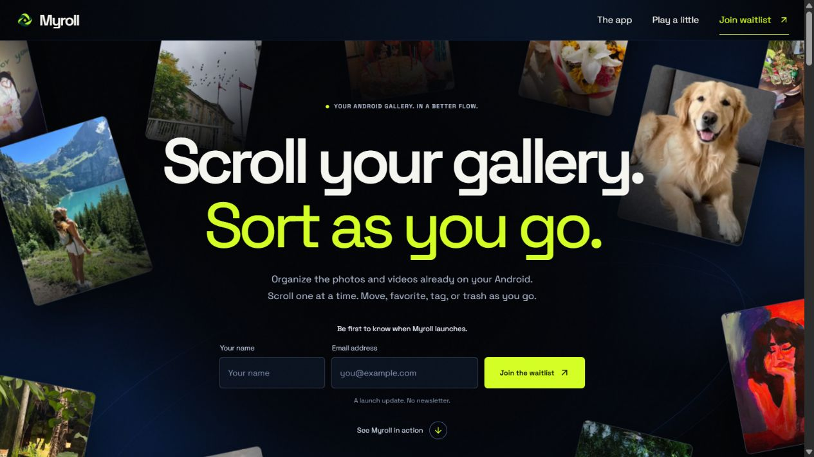

# Myroll
### Scroll your gallery. Sort as you go.

**An Android photo organizer in the making.**

[Visit the launch website ↗](https://myroll-website.vercel.app/) · [Meet the builder](https://www.linkedin.com/in/divyajawalkar22/)

## The idea

A phone gallery fills up quickly. Myroll is my take on making it easier to sort the photos and videos already on your Android, one item at a time.

I’m building around a simple flow: scroll through your gallery, keep the things that matter, and make the rest easier to find.

## The product direction

- Scroll through photos and videos, one at a time.
- Favorite, tag, move to albums or send an item to Trash.
- Keep the gallery and private tags on the phone.
- Make everyday tools feel approachable.

**Status:** in development. The public website is a product preview and launch waitlist, not a download of the finished app.

## Explore the website

The launch website brings the idea to life with an animated photo world, a phone walkthrough and an interactive sorting playground. It uses sample photos and does not access visitors’ galleries.

**Website tools:** Next.js, TypeScript, React, Tailwind CSS and motion libraries.

## Built by me

I’m Divya, a solo builder working on the Android product, its experience and its launch website.

This repository is a public showcase. The website source is private; the Android app source is not distributed here.

---

[Explore Myroll ↗](https://myroll-website.vercel.app/) · [Connect on LinkedIn ↗](https://www.linkedin.com/in/divyajawalkar22/)
